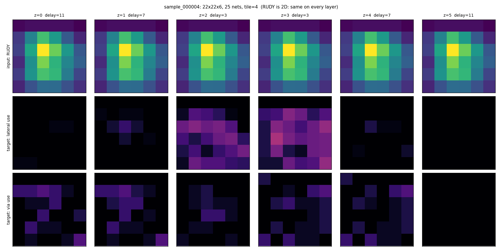
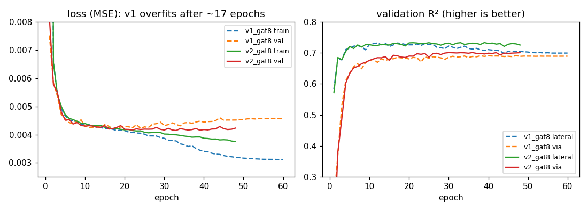
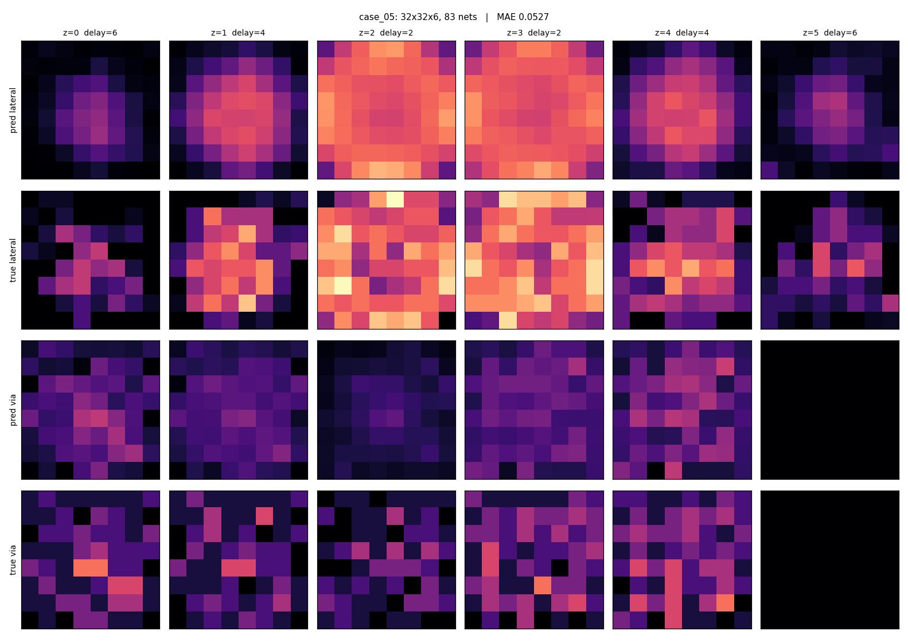

# GNN Routing Optimisation

**Teaching a graph neural network where wires will go, then using it to guide a real router.**
A learning project built on the [Partcl M3D Routing Challenge](https://github.com/partcleda/eda-3d-routing-challenge):
route signal wires through a two-die, monolithic-3D chip stack with the lowest total signal delay.

| Result (official challenge scorer) | Score | vs baseline | All cases legal |
|---|---:|---:|:---:|
| **hard** tier (9 cases) | **1.0180** | **+1.8 %** | 9 / 9 |
| **intro** tier (20 cases) | **1.0145** | **+1.5 %** | 20 / 20 |

A score above 1.0 beats the challenge's reference router. The same model, trained only on random
grids up to 40×40 (plus 70 larger ones), makes useful predictions on grids up to **530×530** and on
**real circuits** it has never seen.

---

## Contents

1. [The competition in plain terms](#1-the-competition-in-plain-terms)
2. [Why a GNN? (and why not a GNN alone)](#2-why-a-gnn-and-why-not-a-gnn-alone)
3. [The pipeline at a glance](#3-the-pipeline-at-a-glance)
4. [Step 1: Generate training data](#step-1--generate-training-data-gnndatagenpy)
5. [Step 2: Turn each chip into a graph](#step-2--turn-each-chip-into-a-graph-gnnfeaturespy)
6. [Step 3: The model](#step-3--the-model-gnnmodelpy)
7. [Step 4: Training](#step-4--training-gnntrainpy)
8. [Step 5: Does it generalize?](#step-5--does-it-generalize-gnnevaluatepy-gnnpredictpy)
9. [Step 6: Route with the GNN](#step-6--route-with-the-gnn-gnnroutepy)
10. [Step 7: Results](#step-7--results)
11. [Repository layout](#repository-layout)
12. [Setup and reproducing everything](#setup-and-reproducing-everything)
13. [Submitting to the challenge leaderboard](#submitting-to-the-challenge-leaderboard)
14. [What I learned and what's still weak](#what-i-learned-and-whats-still-weak)
15. [Next steps](#next-steps)
16. [References](#references)

---

## 1. The competition in plain terms

**The chip.** Two flat layers of circuitry, the **dies**, are stacked face to face. Between them are
6 thin **routing layers**: floors where wires can run. This is **monolithic 3D (M3D)**
integration: building a chip as stacked tiers instead of one flat sheet.

**The task.** Small logic blocks (**cells**) have connection points (**pins**). Pins are grouped into
**nets**: each net has one **driver** (the pin that sends a signal) and one or more **sinks** (pins
that receive it). For every net you must draw a wire **tree** (connected, no loops) from the
driver to all its sinks.

**The grid.** Space is a 3D grid of points `(x, y, z)`. A wire can step one square north, south,
east or west on the same floor, or hop one floor up or down at the same spot (a **via**).
Bottom-die pins sit on floor `z=0` and top-die pins on the top floor.

**The rules (legality).** No grid point or edge may be used by two different nets (that would be a
**short**), and a wire may not pass through another net's pin. If a single net in a single case is
illegal, the whole tier scores 0.

**The goal (delay).** Each floor has a cost per step. The middle floors are **fast** and the floors
next to the dies are **slow**; each via also costs something. For example:

```
floor (z):   0    1    2    3    4    5        via = 3
step cost:   6    4    2    2    4    6
```

**Total delay** = for every sink of every net, add up the cost of its path from the driver. Minimize
that. Long wires want to dive to the fast middle floors, so the middle floors get crowded
(**congestion**), and that is what makes the problem hard.

**Scoring.** Per case: `baseline_delay / your_delay` (above 1 = you beat the reference router).
Per tier: the **geometric mean** of those ratios (the N-th root of their product, so big cases
don't dominate).

**Tiers.**

| Tier | Grid side | Nets | What makes it hard |
|---|---|---|---|
| intro | 16 – 92 | 6 – 139 | Warm-up; sparse |
| hard | 24 – 40 | 62 – 104 | Crowded fast floors; a naive router can't even produce a legal result |
| congested | 64 – 116 | 166 – 302 | Large *and* crowded |
| designs | 77 – 105 | 182 – 344 | Built from real open-source circuits |
| scale | 100 – 156 | 170 – 265 | Large; runtime matters |
| stress | 530 | 901 | One giant case |

**The reference routers** (from the challenge repo, which this project imports):

* **baseline router**: routes nets one by one, growing each net's tree with **Dijkstra** (the
  classic shortest-path algorithm); when a net is blocked it **rips up** the nets in the way and
  **reroutes** them.
* **negotiated-congestion router** ("**PathFinder**"): routes *all* nets while allowing overlaps,
  then makes overused spots more expensive (a "present" cost for being crowded now, a "history"
  cost for having been crowded before) and reroutes, until nothing overlaps. This is the baseline
  for the hard and congested tiers.

### Glossary

| Term | Meaning |
|---|---|
| GNN | Graph Neural Network: a neural net that works on graphs by passing messages between connected nodes |
| Message passing | Each node collects information from its neighbours and updates itself; k layers = each node "hears" k hops away |
| GATv2 | A GNN layer where a node weighs its neighbours' messages with learned **attention** |
| Tile / GCell | A square patch of the grid (here 4×4 points) treated as one graph node |
| RUDY | *Rectangular Uniform wire DensitY*: a classic quick congestion estimate; spread each net's expected wire length evenly over its bounding box and sum over nets |
| HPWL | Half-perimeter wire length: width + height of a net's bounding box |
| Bounding box | The smallest rectangle containing all of a net's pins |
| Prior cost | An extra cost added to grid edges *before* routing, from the GNN's prediction |
| R² | Prediction quality: 0 = no better than always guessing the average, 1 = perfect |
| MSE / MAE | Mean squared / mean absolute error |
| Overfitting | The model memorizes its training examples instead of learning general rules (validation error rises while training error falls) |
| Ablation | Removing one ingredient to measure what it contributes |
| Control experiment | Same setup with the "active ingredient" removed, to prove an effect is real |

---

## 2. Why a GNN? (and why not a GNN alone)

**Why a graph?** A routing grid *is* a graph: points connected to their neighbours, with costs on
the edges. GNNs work directly on that structure and have two properties that matter here:

* **Size-independent.** A GNN layer applies the *same* small function at every node, using only
  its neighbours. A model trained on 40×40 grids therefore runs unchanged on a 530×530 grid, or on
  4, 6 or 8 layers. Classical search routers are size-independent too, but they learn nothing
  between instances.
* **Learns experience.** A classical router rediscovers the congestion of every new chip from
  scratch, iteration by iteration. A trained GNN looks at the pins and nets and predicts it
  immediately, the way an experienced designer glances at a floorplan and says "this corner will
  be crowded".

**Why not let the GNN output the wires directly?** Because legality is all-or-nothing. A neural
network outputs probabilities; one short on one net zeroes the whole tier. So this project follows
the pattern used by successful learned routers in research:

```
the GNN proposes  ──►  a real router decides  ──►  a checker confirms
(where wires will go)   (exact, always legal)     (official scorer)
```

The GNN makes the *decisions smarter*; the router guarantees *correctness*.

---

## 3. The pipeline at a glance

```
 ┌──────────────┐   ┌──────────────┐   ┌──────────────┐   ┌──────────────┐   ┌──────────────┐
 │ 1. datagen   │──►│ 2. features  │──►│ 3-4. model + │──►│ 5. evaluate  │   │ 6. route     │
 │ random chips │   │ chip → tile  │   │    train     │   │ R² on the    │   │ GNN prior →  │
 │ + router     │   │ graph +      │   │ GATv2 GNN    │   │ official     │   │ PathFinder → │
 │ solutions    │   │ usage labels │   │ predicts use │   │ tiers        │   │ legal routes │
 └──────────────┘   └──────────────┘   └──────────────┘   └──────────────┘   └──────┬───────┘
                                                                                     ▼
                                                                         official checker/scorer
```

| Step | File | What it does | Competition equivalent |
|---|---|---|---|
| 1 | `gnn/datagen.py` | Makes thousands of random problems, each solved by a reference router | `m3d/generator.py` + `m3d/suite.py` (how the official cases were made) |
| 2 | `gnn/features.py` | Converts a problem into a graph, and a solution into "how busy each region is" | `m3d/model.py` (instance/solution format) |
| 3 | `gnn/model.py` | The neural network | *(new; no equivalent)* |
| 4 | `gnn/train.py` | Teaches the network to predict busy-ness from the problem alone | *(new)* |
| 5 | `gnn/evaluate.py`, `gnn/predict.py` | Measures predictions on the official benchmarks | the official `reference/` solutions are the "answer key" |
| 6 | `gnn/route.py` | Uses predictions as starting costs inside the negotiated router | `m3d/negotiated.py` (the router we modify) |
| 7 | official `score-suite` | Legality and score | `m3d/checker.py` + `m3d/scorer.py` |

---

## Step 1: Generate training data (`gnn/datagen.py`)

**Problem:** there is no ready-made dataset for this task, and the 45 official cases are far too
few to train on (and should be kept for testing anyway).

**Solution:** make our own. The challenge ships a deterministic instance generator; we call it with
thousands of random settings, and label each instance with a verified legal solution from the
challenge's own routers.

For each sample:

1. **Pick a profile**: `sparse` (30%, intro-like), `medium` (30%), or `dense` (40%, hard-like).
2. **Randomize everything else**: grid side 16–40, **number of layers 4/6/8** (20/60/20%), floor and
   via costs (`center_delay ∈ {1,2}`, `slope ∈ {1,2}`, `via ∈ {2..5}`), nets per unit side, fanout
   (sinks per net), cross-die share, locality. Density is scaled by `layers/6`, because fewer layers
   means less room (without this, dense 4-layer cases needed up to 13 retries).
3. **Generate and solve** with `m3d.generator.generate_feasible`, using the simple router for
   sparse and the negotiated router for medium/dense.
4. **Re-check** the solution with the official checker before saving it, so we never train on an
   illegal label.
5. **Save the raw JSON pair** (`sample_XXXXXX.inst.json` + `.sol.json`) and one line of metadata in
   `index.jsonl`.

Why vary layers and delays? So the model **can't memorize "layer 2 is fast"** and has to learn from
the delay values themselves. That's what lets it work on any stack.

**Details that matter:**
* **Reproducible:** every sample's seed comes from `(split, index)`, so the same command makes the
  same dataset on any machine. Train / val / val_large / test use separate seed ranges, all
  different from the official benchmarks' seed (no leakage).
* **Resumable and crash-safe:** files are written to a temp name and then renamed; re-running skips
  finished samples.
* **CPU only:** the routers are pure Python, so this step doesn't use the GPU at all. Big dense grids
  are slow (a 93×93 dense case took 18 minutes).

**What was generated:**

| Split | Samples | Grid sides | Notes |
|---|---:|---|---|
| train | 3,000 | 16 – 40 | 898 sparse, 905 medium, 1,197 dense; 616/1,790/594 with 4/6/8 layers; ~47 min on 15 cores |
| train (large) | 70 | 48 – 100 | stopped early (the full 300 would have taken ~2 h) |
| val | 200 | 16 – 40 | used to pick the best checkpoint |

---

## Step 2: Turn each chip into a graph (`gnn/features.py`)

**The task we teach first ("Version 1: congestion prediction"):** given only the problem (pins,
nets, floor costs), predict **how heavily a good router will use each region of each floor**.

**Graph construction.**
* **Nodes:** the grid is cut into **4×4 tiles**; one node per tile per layer. A 40×40×6 chip becomes
  10×10×6 = 600 nodes. (Coarser than the real grid on purpose: small graphs, fast training, and
  congestion is a regional property.)
* **Edges:** each node connects to its 4 neighbours on the same layer and to the tiles directly
  above and below. Each edge carries `[is_via, step_cost / max_step_cost]`.

**Node features (19), none of which depend on absolute grid size or layer index:**

| # | Feature | Meaning | Why it helps |
|---|---|---|---|
| 0 | `layer_delay_norm` | this floor's step cost ÷ slowest floor's | fast floors attract wire |
| 1 | `layer_fastness` | 1 = fastest floor of this stack, 0 = slowest | same, as a rank |
| 2 | `via_norm` | via cost ÷ slowest step cost | expensive vias = fewer floor changes |
| 3 | `rel_z` | 0 = bottom die floor, 1 = top die floor | position in the stack, for any layer count |
| 4 | `is_die_layer` | floor touches a die | pins live there |
| 5 | `area_frac` | how much of the tile is inside the grid | edge tiles can be partial |
| 6–8 | `pin_density_here/bottom/top` | pins per point on this tile, and on the dies below/above | wires start and end at pins |
| 9 | `rudy_all` | RUDY congestion estimate (log scale) | classic "how much wire passes here" guess |
| 10–12 | `rudy_short/medium/long` | RUDY split by net length (≤4, ≤12, >12 steps) | long nets dive to fast floors; short ones don't |
| 13 | `rudy_cross_die` | RUDY of nets connecting both dies | they must cross every floor |
| 14 | `rudy_fanout` | RUDY weighted by number of sinks | the score counts every sink |
| 15 | `cross_pin_here` | pins of die-crossing nets on this tile | *(v2)* where via stacks start |
| 16 | `cross_pin_column` | same, summed over the whole column | *(v2)* via stacks run through all floors |
| 17 | `cross_sink_column` | same, weighted by sinks | *(v2)* |
| 18 | `edge_dist` | tiles to the nearest border, capped at 4 | *(v2)* separates border from interior on any size |

Features 0–14 are **v1**; 15–18 were added in **v2**. Features are append-only, so v1 models still
work: they just read the first 15 columns.

**Targets (what the model must predict), from the router's solution:**
* `lateral_usage`: the fraction of the tile-layer's grid edges that the solution uses
* `via_usage`: the fraction of possible vias from this floor to the next that are used
  (undefined on the top floor, so it's masked out of the loss)

**Sanity check:** converting the targets back to edge counts recovers *every* edge of the solution
(571 of 571 in the test sample).



*Top row: the RUDY input is identical on every floor (it's 2D). Middle row: the router actually put
nearly all wire on the fast floors z=2 and z=3. That gap is exactly what the GNN must learn: how
wire distributes across floors by speed, and sideways around crowded areas.*

---

## Step 3: The model (`gnn/model.py`)

```
19 features ─► MLP encoder ─► [ GATv2 attention + feed-forward ] × 8 ─► MLP head ─► sigmoid ─► 2 usages
```

* **GATv2Conv** (attention message passing): each tile-layer updates itself from a learned,
  attention-weighted mix of its neighbours. The edge features let it treat "sideways on a slow
  floor" differently from "via up".
* **Pre-norm residual blocks** (`h = h + layer(norm(h))`) keep an 8-layer stack trainable.
* **8 layers** ⇒ each node sees ~8 tiles (~32 grid steps) sideways and the whole height of the stack.
* **Sigmoid output** because usages are fractions in [0, 1].
* **835,842 parameters** (v2), which is small.
* `--layers 0` gives the same network **without message passing** (a per-node MLP). That's the
  ablation that tests whether looking at neighbours helps.

**Competition equivalent:** none. This replaces the "discover congestion by trial and error" loop of
PathFinder with a learned prediction made before routing starts.

---

## Step 4: Training (`gnn/train.py`)

* **Loss:** masked mean squared error between predicted and true usage.
* **Inputs are standardized** with training-set mean/std (stored in the checkpoint).
* **Optimizer:** AdamW, learning rate 1e-3 with warm-up and cosine decay, gradient clipping.
* **Reference scores printed first**, so the GNN's number means something:
  * `mean`: always predict the average (R² = 0 by definition)
  * `linear`: least squares on each node's own features (no graph)
* **v2 adds** dropout 0.1 and **early stopping** (stop after 15 epochs without improvement), because
  v1 overfit.
* The best checkpoint (lowest validation loss) is saved with everything needed to use it: model
  config, weights, normalization stats, feature list.

**Hardware:** an RTX 4060 **laptop** GPU is plenty. The entire dataset (~1M nodes, ~60 MB) fits in
GPU memory; one epoch takes ~11 s; a full run takes ~11 min.



*v1 (dashed) starts overfitting after ~17 epochs: training loss keeps falling while validation loss
rises. v2 (solid) with dropout + early stopping trains longer before stopping (best at epoch 33).*

**Validation results (200 held-out random chips):**

| Model | Lateral R² | Via R² |
|---|---:|---:|
| always predict the average | 0.00 | 0.00 |
| linear, no graph | 0.57 | 0.40 |
| MLP, no message passing (`--layers 0`) | 0.68 | 0.68 |
| **GNN v1** (8 × GATv2) | 0.73 | 0.69 |
| **GNN v2** (+ cross-die features, large samples, dropout) | **0.73** | **0.70** |

The GNN beats every non-graph baseline, though the margin over the plain MLP is modest. Part of the
reason is that RUDY already summarizes each net's bounding box, so each node starts with some
neighbourhood information.

---

## Step 5: Does it generalize? (`gnn/evaluate.py`, `gnn/predict.py`)

The real test: the **official benchmarks**, never used for training and mostly much bigger than the
training grids. The "truth" is each case's official reference solution.

| Tier | Max grid | v1 lateral / via R² | v2 lateral / via R² |
|---|---:|---|---|
| hard | 40 | 0.745 / 0.430 | **0.750 / 0.446** |
| intro | 92 | **0.652** / 0.444 | 0.632 / **0.460** |
| congested | 116 | 0.589 / 0.308 | **0.717 / 0.338** |
| designs (real circuits) | 105 | **0.684 / 0.468** | 0.642 / 0.422 |
| scale | 156 | 0.637 / 0.354 | **0.640 / 0.364** |
| stress | **530** | 0.535 / 0.167 | **0.546 / 0.179** |

Takeaways:
* **Size generalization works:** a model trained on grids up to 40 (plus 70 up to 100) still
  predicts usefully on a 530×530 grid and on real circuits.
* The 70 large training samples are the likely cause of v2's big jump on `congested` (the only tier
  that is both large and dense).
* v2 is worse on `designs`: real circuits are structured differently from the random generator, and
  v2 may fit the generator more closely.
* Via prediction is consistently harder than lateral prediction.



*Rows: predicted lateral use, true lateral use, predicted vias, true vias, for each floor. The model
clearly learned the floor physics (bright fast middle floors, dark slow outer ones). Its predictions
are **smoother** than the truth: with an MSE loss, an unsure model predicts the average of the
possibilities, and the router's exact choice among equally good routes is partly arbitrary anyway.*

---

## Step 6: Route with the GNN (`gnn/route.py`)

PathFinder normally *discovers* congestion over many iterations. Here the GNN *predicts* it before
routing starts, and every grid edge gets an extra **prior cost**:

```
edge_cost = step_delay × (1 + fade × alpha × predicted_usage^gamma  +  history  +  present)
                              └───────────── GNN prior ─────────────┘  └── PathFinder's own ──┘
```

* `alpha` = prior strength (default 1); `gamma = 2` focuses the penalty on predicted hot spots.
* **Fading** (`fade = (pres_fac0 / pres_fac)^decay`): PathFinder's crowding penalty grows 1.7× per
  iteration, so with `decay = 1` the prior is ~7% of its strength after 5 iterations. The GNN steers
  the first passes; then the router's real measurements take over. A *constant* prior made the
  negotiation oscillate and fail to converge.
* `alpha = 0` is **exactly** the official negotiated router. This is checked: it reproduces the
  baseline's delay to the unit (score 1.0000).
* **Portfolio (`--fallback best`):** also run the plain negotiated router and keep the better legal
  result per case. Runtime counts both runs, so the comparison is honest. This guarantees every case
  is legal.

**Competition equivalent:** `GuidedNegotiated` subclasses the challenge's `m3d.negotiated.Negotiated`;
the only change is the prior term in the edge cost. Legality still comes from the router, and every
output is re-verified with `m3d.checker.check`.

### The control experiment: is it the GNN, or just any perturbation?

PathFinder is sensitive to its starting costs, so *any* change could help or hurt by luck. To prove
the GNN's predictions carry real information, we compared against a **shuffled prior**: the same
predicted values, randomly scrambled across positions within each floor. Same strength, same
"middle floors are busy" profile, **no spatial information**.

| Prior (hard tier, v1 model, 100-iteration cap) | Legal | Delay vs baseline (legal cases only) |
|---|---:|---:|
| **GNN predictions**, alpha 1 | 7 / 9 | **+2.2 % better** |
| shuffled predictions, alpha 1 | 7 / 9 | −1.2 % worse |
| GNN predictions, alpha 4 | 7 / 9 | +0.5 % |
| shuffled predictions, alpha 4 | 8 / 9 | −0.4 % |

**The GNN's spatial predictions genuinely help**; scrambled ones hurt. Both setups sometimes fail to
converge, which is why the final submissions use the portfolio fallback.

---

## Step 7: Results

Final run: **v2 model, alpha 1, fading prior, 100-iteration cap, portfolio fallback**. Scored with
the challenge's official `python -m m3d.cli score-suite`.

**hard** (baseline = negotiated router):

| Case | Baseline delay | Our delay | Ratio | Route used |
|---|---:|---:|---:|---|
| case_01 | 11,938 | 11,938 | 1.0000 | plain |
| case_02 | 18,910 | 18,910 | 1.0000 | plain |
| case_03 | 14,724 | 14,724 | 1.0000 | plain |
| case_04 | 18,077 | 17,717 | **1.0203** | GNN |
| case_05 | 21,051 | 20,235 | **1.0403** | GNN |
| case_06 | 27,134 | 25,940 | **1.0460** | GNN |
| case_07 | 31,341 | 30,999 | **1.0110** | GNN |
| case_08 | 30,886 | 30,020 | **1.0288** | GNN |
| case_09 | 27,802 | 27,352 | **1.0165** | GNN |
| **aggregate** | | | **1.0180** | 6 GNN / 3 plain |

**intro** (baseline = simple rip-up router): aggregate **1.0145**, 20/20 legal, GNN route chosen on
15 of 20 cases. Note that on intro part of the gain may come from using the negotiated router at all
rather than from the GNN; I didn't run plain negotiated alone on intro to separate the two.

**Runtime** (CPU routing + GPU inference, both routers counted): hard 703 s total, intro 3,503 s total.

**Leaderboard context (October 2026):** the top entries are about 1.41 (hard) and 1.16 (intro), from
heavy search (rip-up-and-reroute, large neighbourhood search) running for hours. This project beats
the baseline with a learned prior on top of a stock router. Closing the gap to the top would mean
using the GNN to guide *that* kind of search (see [Next steps](#next-steps)).

The solution files are in `results/hard/` and `results/intro/` (with `runtime.json`); training and
routing logs are in `results/logs/`.

---

## Repository layout

```
GNN_Routing_Optimisation/
├── README.md               this file
├── requirements.txt        torch, torch_geometric, numpy, matplotlib
├── gnn/
│   ├── _paths.py           finds the challenge repo (its m3d toolkit + benchmarks)
│   ├── datagen.py          Step 1: random instances + router labels → raw JSON
│   ├── features.py         Step 2: instance → tile graph; solution → usage targets
│   ├── model.py            Step 3: GATv2 congestion GNN
│   ├── train.py            Step 4: training loop, baselines, checkpoints
│   ├── evaluate.py         Step 5: R² on the official tiers
│   ├── predict.py          Step 5: prediction-vs-truth pictures
│   └── route.py            Step 6: GNN-guided negotiated router + controls + submission writer
├── models/
│   ├── v1_gat8.pt          15 features, no dropout
│   └── v2_gat8.pt          19 features, dropout 0.1 (used for the results)
├── results/
│   ├── hard/               official-format solutions + runtime.json (score 1.0180)
│   ├── intro/              official-format solutions + runtime.json (score 1.0145)
│   └── logs/               training metrics/logs, routing experiment logs
└── docs/figures/           images used in this README
```

Generated data (`gnn/data/`), local checkpoints (`gnn/checkpoints/`) and run logs (`gnn/runs/`) are
git-ignored: they're large and fully reproducible.

---

## Setup and reproducing everything

**1. Get both repos side by side** (this project imports the challenge's `m3d` toolkit and reads its
benchmarks; it finds a sibling folder named `Partcl-Competition` or `eda-3d-routing-challenge`, or
the path in the `M3D_REPO` environment variable):

```
D:/
├── Partcl-Competition/          git clone https://github.com/partcleda/eda-3d-routing-challenge
└── GNN_Routing_Optimisation/    this repo
```

**2. Install** (Python 3.9+; install the CUDA build of PyTorch for your GPU first):

```bash
pip install -r requirements.txt
```

**3. Run everything from this repo's root.** `python -m gnn.<step>` needs the root as the current
directory, because Python looks for the `gnn` package there.

```bash
# Step 1: data (CPU; ~47 min for 3,000 small samples on 15 cores)
python -m gnn.datagen --split train --n 3000
python -m gnn.datagen --split val --n 200
python -m gnn.datagen --split train --start 3000 --n 70 --min-side 48 --max-side 100
python -m gnn.datagen --split train --summary

# Step 2: features (~2 min)
python -m gnn.features --split train
python -m gnn.features --split val
python -m gnn.features --viz train/sample_000004

# Steps 3-4: train (~11 min on a laptop RTX 4060)
python -m gnn.train --epochs 60 --run v2_gat8
python -m gnn.train --epochs 60 --layers 0 --run v2_mlp          # no-graph ablation

# Step 5: generalization to the official tiers
python -m gnn.evaluate --ckpt models/v1_gat8.pt models/v2_gat8.pt
python -m gnn.predict --ckpt models/v2_gat8.pt --case benchmarks_hard/case_05.json --sol benchmarks_hard/reference/case_05.sol.json

# Step 6: routing experiments
python -m gnn.route --ckpt models/v2_gat8.pt --suite benchmarks_hard --alpha 0 1 2 --max-iters 100 --workers 4
python -m gnn.route --ckpt models/v2_gat8.pt --suite benchmarks_hard --alpha 1 --max-iters 100 --control shuffle

# Step 7: produce a full legal submission and score it officially
python -m gnn.route --ckpt models/v2_gat8.pt --suite benchmarks_hard --alpha 1 --fallback best --max-iters 100 --workers 8 --out-dir results/hard
```

Then score it, from the challenge repo:

```bash
python -m m3d.cli score-suite --suite benchmarks_hard --submission-dir ../GNN_Routing_Optimisation/results/hard
```

To skip training, use the shipped `models/v2_gat8.pt` directly in Steps 5–7.

---

## Submitting to the challenge leaderboard

The leaderboard is PR-based in the challenge repo. A submission PR may only touch
`submissions/<tier>/<name>/`, `LEADERBOARD.md` and the README's generated leaderboard block.

1. Copy `results/hard/*` into `submissions/hard/<your-name>/` in your fork of the challenge repo.
2. Add a `meta.json`, for example:
   ```json
   {"author": "<you>", "url": "https://github.com/<you>/GNN_Routing_Optimisation",
    "method": "GATv2 congestion GNN as a fading prior inside negotiated-congestion routing (+ plain-router portfolio)",
    "date": "2026-10-08"}
   ```
3. From the challenge repo: `python -m m3d.cli score-suite ...`, then
   `python -m m3d.cli leaderboard-all`, then `python scripts/verify_submissions.py`.
4. Commit only those files and open the PR.

---

## What I learned and what's still weak

* **A GNN alone can't route this problem.** Legality is binary, so the GNN must guide an exact
  router, not replace it.
* **Size generalization is real but not free.** The model works on grids 13× larger than anything
  in training, but its advantage over a plain MLP shrinks on big grids, and adding a few large
  samples helped `congested` a lot.
* **Controls matter.** Without the shuffled-prior experiment, a +2% gain could have been luck.
  With it, the GNN's spatial information is shown to help.
* **Blurry predictions.** The MSE loss averages over the many equally good routings, so
  predictions are smoother than any real solution.
* **Labels are only as good as the router that made them.** The GNN imitates the reference
  routers, not optimal routings.
* **Convergence is fragile.** Some guided runs don't converge within 100 PathFinder iterations,
  which is why the portfolio fallback exists.
* **Confounded v2.** v2 changed features, data and regularization at once, so the individual
  effects aren't separated yet.
* **Small final gains** (+1.5–1.8%) compared with top search-based entries (+16–41%).

## Next steps

1. **Confidence-aware guidance:** predict uncertainty as well as usage (e.g. a Gaussian or quantile
   head, or an ensemble), apply the prior only where the model is confident, and fall back to plain
   PathFinder elsewhere.
2. **Guide the search, not just the start:** use the GNN to choose which nets to rip up in a
   rip-up-and-reroute or large-neighbourhood-search loop ("learning to destroy").
3. **Per-net predictions (Version 2 model):** predict, for each net, which grid points its tree
   should use (an edge heatmap), and decode with A*.
4. **Better labels:** train on solutions from a stronger router.
5. **Clean ablations:** separate the effects of the new features, the large samples and dropout.
6. **Faster data generation:** port the router's inner loop to C++/Rust/Numba to afford many more
   large samples.

---

## References

* Partcl, **M3D Routing Challenge**: https://github.com/partcleda/eda-3d-routing-challenge (MIT)
* L. McMurchie, C. Ebeling, **PathFinder: A Negotiation-Based Performance-Driven Router for FPGAs** (FPGA 1995)
* S. Brody, U. Alon, E. Yahav, **How Attentive are Graph Attention Networks?** (ICLR 2022), the GATv2 layer
* P. Veličković et al., **Graph Attention Networks** (ICLR 2018)
* R. Kirby et al., **CongestionNet: Routing Congestion Prediction Using Deep Graph Neural Networks** (VLSI-SoC 2019)
* X. Du et al., **HubRouter: Learning Global Routing via Hub Generation and Pin-hub Connection** (NeurIPS 2023)
* Q. Cappart et al., **Combinatorial Optimization and Reasoning with Graph Neural Networks** (JMLR 2023)
* C. K. Joshi, T. Laurent, X. Bresson, **An Efficient Graph Convolutional Network Technique for the Travelling Salesman Problem** (2019)
* A. B. Kahng, J. Lienig, I. L. Markov, J. Hu, **VLSI Physical Design: From Graph Partitioning to Timing Closure** (Springer)
* PyTorch Geometric: https://pytorch-geometric.readthedocs.io

---

*Built with help from Claude Code. The `m3d` toolkit and all benchmark data belong to the challenge
repository and are not redistributed here.*
